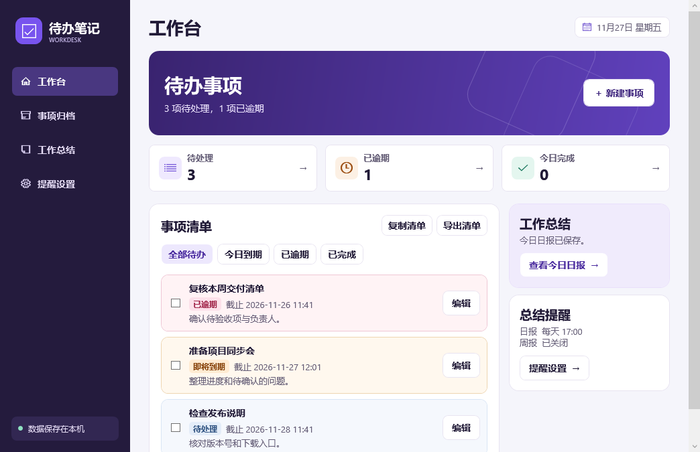
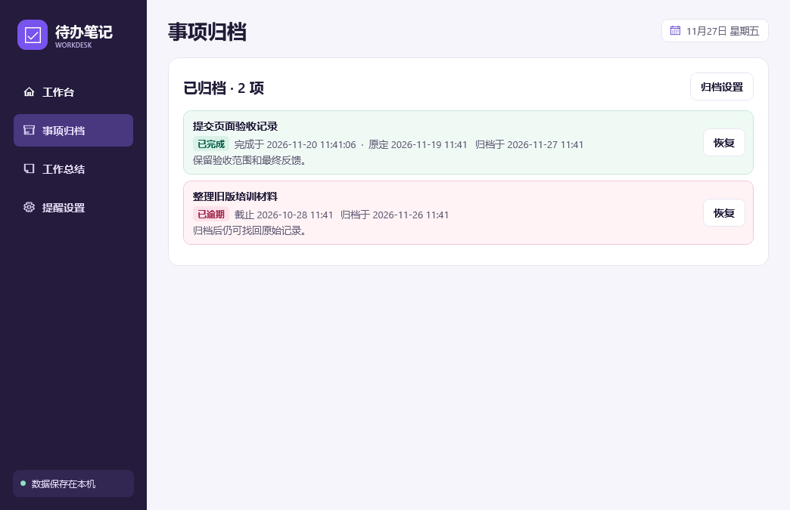
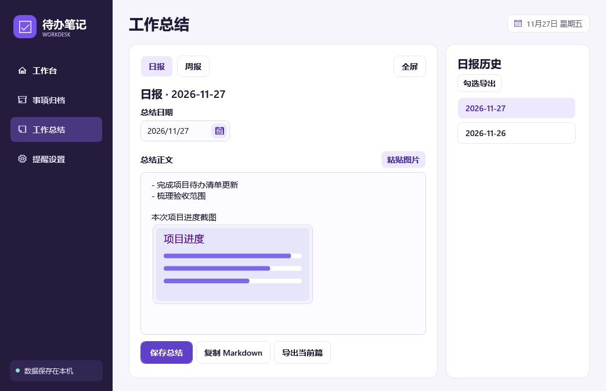

# 待办笔记 · WorkDesk

轻量的 Windows 桌面应用，支持待办事项、截止提醒、完成时间记录，以及日报和周报。

## 下载

[下载待办笔记 v1.5.1](./release/WorkDesk-v1.5.1.exe?raw=true)

下载后双击 EXE，即可在装有 .NET Framework 4.8 或 4.8.1 的 Windows 10／11 上运行。更新前请先从托盘退出旧版，再打开新版。

SHA-256：`e14d2a45567393ad6c9ab346b2d8f5aa77b594bfbf1b6105b159d32e9fe763df`

[查看 v1.5.1 的改动与升级说明](./CHANGELOG.md#v151)

## 界面预览

### 工作台

每个事项使用独立卡片。蓝色是待处理，橙色是即将到期，红色是已逾期，绿色是已完成。点击顶部统计卡可跳到相应筛选，任务较多时可滚动列表。



删除前会显示事项名称，默认选中「取消」。


### 事项归档

独立的归档页保留事项状态、时间及备注，可将归档事项恢复到工作台。



### 工作总结

按日或周写总结，支持粘贴截图。正文和历史区会随窗口拉伸和最大化而扩大，右侧可以切换记录或勾选导出。



离开未保存的总结时，可以继续编辑、不保存并离开，或保存并离开。


### 字体与字号

在「提醒设置」中分别选择界面和编辑框的字体与字号，保存后即时应用。编辑框设置会用于总结正文和事项的标题、备注。


### 桌面提醒

关闭窗口后，应用继续在托盘运行。弹窗按事项截止、日报和周报分色，点对应按钮即可跳转。


## 使用待办笔记

- **工作台**点「新建事项」并设置可选截止时间。勾选完成会自动记录时间，可在「编辑」里补记或修正。清单可以复制或导出为 Markdown。
- **事项归档**在「提醒设置 → 事项自动归档」分别设置完成、逾期后保留的天数，默认 `0` 表示关闭。应用在运行时（含托盘）自动处理符合条件的事项。左侧「事项归档」可以查看或恢复，恢复时保留原完成时间与截止时间。完整清单导出也包含已归档事项。
- **工作总结**按日期写日报、按自然周写周报。在正文按 `Ctrl+V` 或点击「粘贴图片」，即可把截图插在光标处。右键图片可复制或移除。点「全屏」或按 `F11` 可展开编辑区，继续从右侧切换历史记录，按 `Esc` 退出。
- **导出总结**点「导出当前篇」保存当前一篇，或从历史区点「勾选导出」合并所选记录。普通 `.md` 和「复制 Markdown」会内嵌截图，适用于支持内嵌图片的 Markdown 预览。
- **跨工具分享带图总结**选「网页（内嵌图片）」可用浏览器直接打开单个 `.html` 文件。需要普通图片附件时，选「Markdown 和图片压缩包」，完整解压后打开其中的 Markdown。
- **提醒设置**可调整排程、开启登录启动或导出全部备份。关闭窗口会回到托盘。彻底退出时，从托盘菜单选择「退出待办笔记」。

### 本地数据

已保存的记录位于 `%LOCALAPPDATA%\WorkDesk\state.json`。设置页支持导出完整 JSON 备份，以及便于阅读和分享的 Markdown、网页或压缩包。完整 JSON 备份包含事项及归档设置、总结及图片、提醒设置和提示记录。

手动恢复完整 JSON 备份时，先退出待办笔记并另存现有数据文件，再把选定的备份复制为 `%LOCALAPPDATA%\WorkDesk\state.json` 并重新打开应用。

## 构建和自测

在 Windows PowerShell 中运行：

```powershell
.\build.ps1
.\test.ps1
```

构建产物为 `dist/WorkDesk.exe`。自测在隔离目录里运行，覆盖事项保存、删除确认、完成时间、自动归档与恢复、总结、定时提醒、托盘和导出。

## 设计文档

- [需求分析与验收](docs/requirements.md)
- [应用架构与开发计划](docs/design.md)
