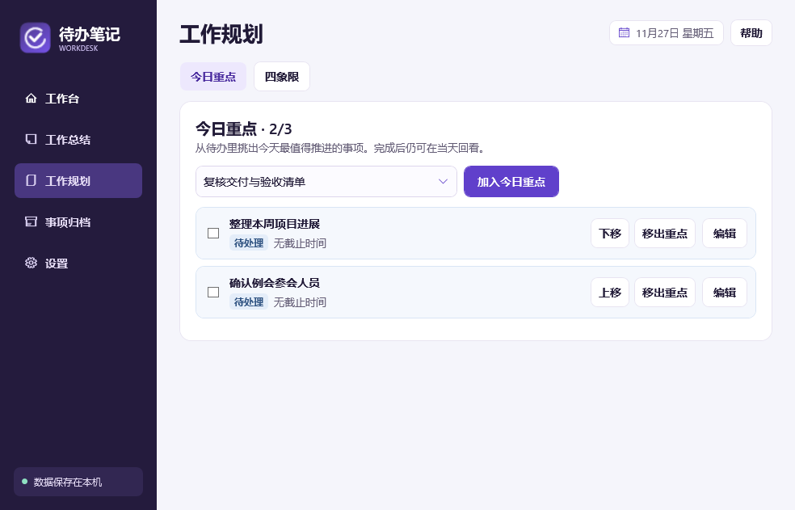
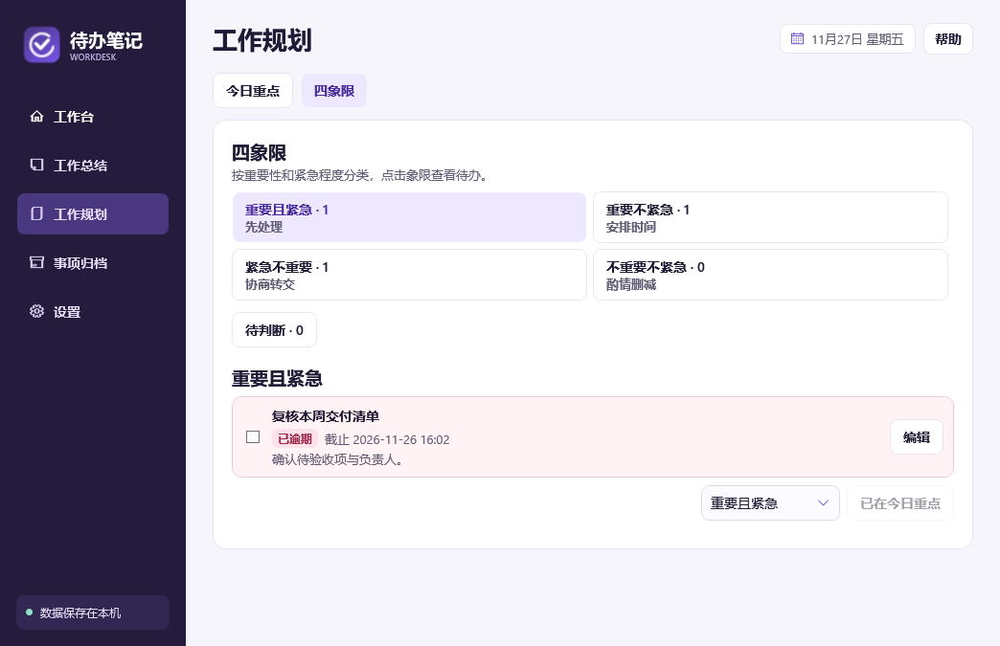
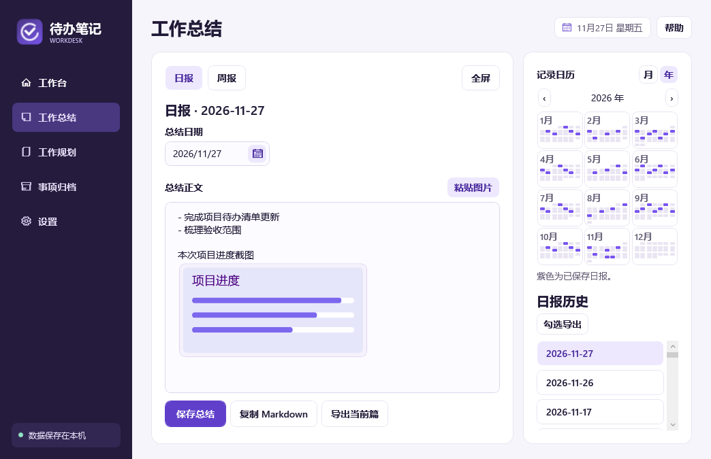
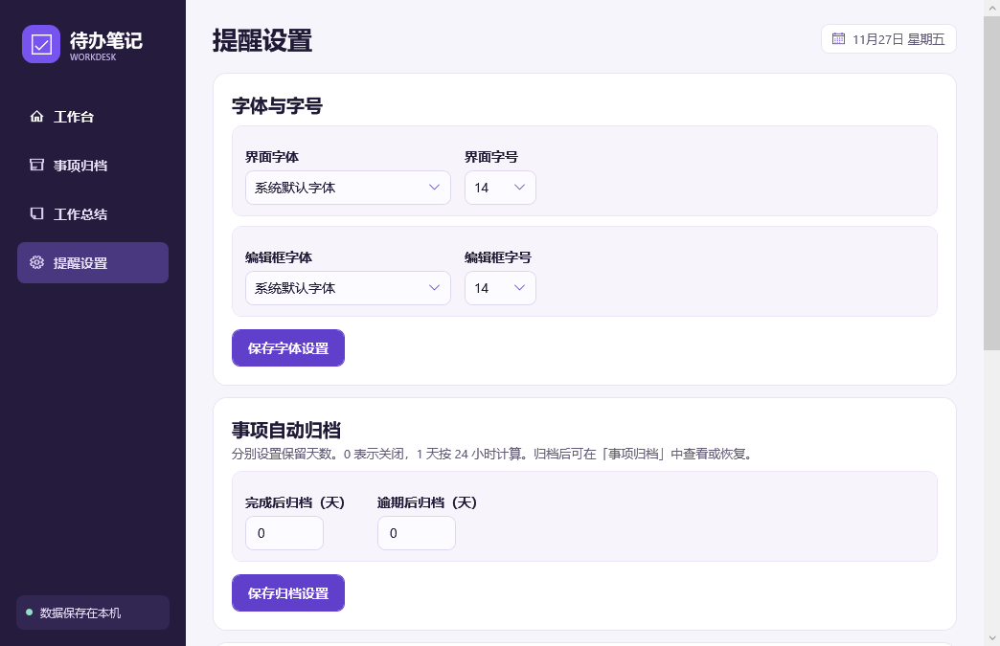
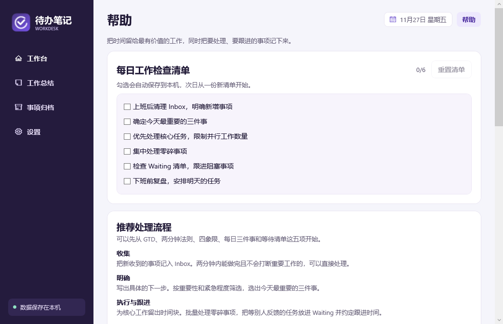
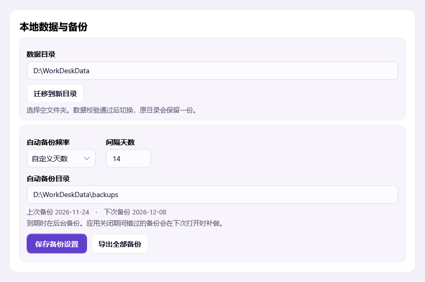

# 待办笔记 · WorkDesk

轻量的 Windows 桌面应用，支持待办事项、截止提醒、完成时间记录，以及日报和周报。

## 下载

[下载待办笔记 v1.8.3](./release/WorkDesk-v1.8.3.exe?raw=true) · [历史版本](https://github.com/xiaogan2015-design/workdesk-reminder/releases)

当前版本的单文件 EXE **小于 200 KiB**，实测为 **201,216 字节**。

下载后双击 EXE，即可在装有 .NET Framework 4.8 或 4.8.1 的 Windows 10／11 上运行。更新前请先从托盘退出旧版，再打开新版。

SHA-256：`569405a531cd6da673bf7dfe7c7190f80d6dbb2cb1ae06b1fa8177a07cb94c83`

[查看 v1.8.3 的改动](./CHANGELOG.md#v183)

## 界面预览

### 工作台

每个事项使用独立卡片。蓝色是待处理，橙色是即将到期，红色是已逾期，绿色是已完成。点击顶部统计卡可跳到相应筛选，任务较多时可滚动列表。


删除前会显示事项名称，默认选中「取消」。


### 工作规划

从下拉框选择最多三项待办作为今日重点，支持在任务卡片内调序、移出和勾选完成。工作台显示当天的重点。在四象限坐标上选择一个区域，可筛选对应事项，并在卡片内重新分类或加入今日重点。





### 事项归档

独立的归档页保留事项状态、时间及备注，可将归档事项恢复到工作台。


### 工作总结

按日或周写总结，支持粘贴截图。正文和历史区会随窗口拉伸和最大化而扩大，右侧可以切换记录或勾选导出。


右侧「记录日历」可切换月览和年览。紫色日期已有记录，点年览里的月份可展开，再点日期打开对应日报或周报。周报标在该周的周一。



离开未保存的总结时，可以继续编辑、不保存并离开，或保存并离开。


### 字体与字号

在「设置」中分别选择界面和编辑框的字体与字号，保存后即时应用。编辑框设置会用于总结正文和事项的标题、备注。



### 桌面提醒

关闭窗口后，应用继续在托盘运行。弹窗按事项截止、日报和周报分色，点对应按钮即可跳转。


### 待办管理帮助

点窗口右上角「帮助」阅读待办技巧、推荐流程和六种清单状态。每日工作检查清单可以勾选和重置，进度自动保存在本机，次日从新清单开始。



## 使用待办笔记

- **工作台**点「新建事项」并设置可选截止时间。勾选完成会自动记录时间，可在「编辑」里补记或修正。清单可以复制或导出为 Markdown。
- **事项归档**在「设置 → 事项自动归档」分别设置完成、逾期后保留的天数，默认 `0` 表示关闭。应用在运行时（含托盘）自动处理符合条件的事项。左侧「事项归档」可按归档月份查看或恢复，恢复时保留原完成时间与截止时间。完整清单导出也包含已归档事项。
- **工作总结**按日期写日报、按自然周写周报。在正文按 `Ctrl+V` 或点击「粘贴图片」，即可把截图插在光标处。右键图片可复制或移除。点「全屏」或按 `F11` 可展开编辑区，继续从右侧切换历史记录，按 `Esc` 退出。
- **清除总结**把已保存日报或周报中的文字和图片清空，再点「保存总结」，这篇记录会从历史、记录日历和导出选项中移除。
- **日报自动填充**打开今天的空白日报时，自动列出当天完成的事项。清单可编辑，点击「保存总结」后写入日报。主动清除当天日报后，重新打开会保持空白。
- **导出总结**点「导出当前篇」保存当前一篇，或从历史区点「勾选导出」合并所选记录。普通 `.md` 和「复制 Markdown」会内嵌截图，适用于支持内嵌图片的 Markdown 预览。
- **跨工具分享带图总结**选「网页（内嵌图片）」可用浏览器直接打开单个 `.html` 文件。需要普通图片附件时，选「Markdown 和图片压缩包」，完整解压后打开其中的 Markdown。
- **设置**可调整提醒排程、开启登录启动或导出全部备份。关闭窗口会回到托盘。彻底退出时，从托盘菜单选择「退出待办笔记」。

### 本地数据

默认数据目录是 `%LOCALAPPDATA%\WorkDesk`。在「设置 → 本地数据与备份」可查看路径，或选一个空文件夹迁移。应用校验新目录后才切换，原目录保留。新版首次保存时会把归档事项、总结正文和图片分别写入 `archives`、`reports`、`images`。复制正在使用的数据时，请复制整个数据目录。

自动备份默认关闭，可设置每隔 7 天、每隔一个自然月或每隔 1 至 3650 天。首次启用会在后台备份，此后从上次成功日期计算，下次运行时会补做到期尚未执行的备份。每份完整备份是独立的 JSON，保存在数据目录的 `backups` 子目录，包含事项、归档、总结及图片、规划和设置。也可随时手动导出。



恢复完整 JSON 时，先从托盘退出并另存当前数据目录，再把备份文件复制为当前数据目录下的 `state.json`，重新打开应用。自动备份文件和手动导出的完整 JSON 都可这样恢复。Markdown、网页和 Markdown 压缩包用于分享。

## 构建和自测

在 Windows PowerShell 中运行：

```powershell
.\build.ps1
.\test.ps1
```

构建产物为 `dist/WorkDesk.exe`。自测在隔离目录里运行，覆盖事项保存、删除确认、完成时间、自动归档与恢复、每日检查清单、总结、定时提醒、托盘和导出。

## 设计文档

- [需求分析与验收](docs/requirements.md)
- [应用架构与开发计划](docs/design.md)
